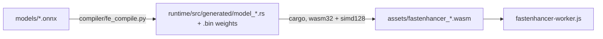

# FastEnhancer → standalone WebAssembly

This folder compiles the [FastEnhancer](https://github.com/aask1357/fastenhancer) streaming ONNX exports into
self-contained WebAssembly modules (`assets/fastenhancer_{s,t}.wasm`). It replaces ONNX Runtime Web, so the
extension no longer ships the ~12 MB ORT runtime.



## How it works

The streaming graphs have fully static shapes (512-sample hop and fixed-size caches), so
[`compiler/fe_compile.py`](compiler/fe_compile.py) lowers the whole network ahead of time into straight-line Rust:

- shape/index arithmetic is constant-folded at build time;
- `Reshape` / `Transpose` / `Slice` / `Gather` / `Split` / `Squeeze` / `Unsqueeze` become zero-copy strided views,
  so data is only copied when a kernel needs it;
- `Conv`, `ConvTranspose`, `Gemm` and `MatMul` all run through one SIMD128 SGEMM micro-kernel (4×8 register tile;
  Gemm weights are pre-transposed);
- the kernel-3 / stride-1 convolutions (the encoder and decoder blocks) use **Winograd F(2,3)**: four GEMMs on
  half-length inputs, so 1.5× fewer multiply-adds. The input and output transforms are vectorized through an
  even/odd sample split;
- bias, `Gemm` bias and **SiLU** (`Sigmoid(x)*x` is pattern-matched) are fused into the GEMM / Winograd epilogue and
  applied on the register tile, so there is no extra pass over memory;
- `exp`, `log`, `pow`, `sigmoid`, `tanh` and `softmax` are vectorized SIMD polynomials; `DFT` is a radix-2 FFT with
  precomputed twiddles;
- all intermediates share one scratch arena, laid out by a liveness-based memory planner (for example, 341 KB
  instead of 2.6 MB for the Standard model).

[`runtime/`](runtime) holds the hand-written kernels ([`kernels.rs`](runtime/src/kernels.rs)) and the C ABI
([`lib.rs`](runtime/src/lib.rs)). Weights are embedded in the module's data segment, so each `.wasm` is fully
standalone and needs no imports.

### Build target

Each model ships as a single `fastenhancer_X.wasm` built with SIMD128 only (no relaxed SIMD), so it runs on every
engine that supports WebAssembly SIMD.

### Worker-level optimizations

- **Mono dedup:** mono sources arrive as identical L/R. When a hop is dual-mono and both streams are in the same
  state, only the left stream runs and its output is copied, which halves the CPU cost. When stereo resumes, the
  right stream first takes a copy of the left state (`fe_stream_copy_state`), so the output stays bit-identical to
  running both channels. After about 1 s of continuous mono, a diverged right stream re-joins the left one.
- **Event-driven scheduling:** the audio worklet calls `Atomics.notify` once a full hop is buffered, and the worker
  waits with `Atomics.waitAsync` instead of polling every 4 ms. This lowers latency and avoids idle wake-ups.
  If `waitAsync` is unavailable, it falls back to the old timer.

### Exports

| Export | Description |
|---|---|
| `fe_hop_size()` | samples per hop (512) |
| `fe_stream_new()` / `fe_stream_free(s)` | one independent stream (caches + I/O) per audio channel |
| `fe_stream_input(s)` / `fe_stream_output(s)` | pointers to the hop-sized `f32` I/O buffers in `memory` |
| `fe_stream_process(s, wet)` | run one hop; `output = input·(1−wet) + enhanced·wet` |
| `fe_stream_reset(s)` | clear the recurrent and overlap-add state |
| `fe_stream_copy_state(dst, src)` | make `dst`'s model state identical to `src`'s |
| `fe_num_caches()`, `fe_cache_len(i)`, `fe_stream_cache(s, i)` | cache introspection (used by the tests) |

## Building

Requirements: Python 3 with `onnx` and `numpy` (`onnxsim` is optional but recommended), plus Rust with
`rustup target add wasm32-unknown-unknown`.

```powershell
python wasm/build.py                  # codegen + both models, copied into assets/
python wasm/compiler/fe_compile.py --help   # e.g. --no-winograd to lower K=3 convs via im2col + GEMM
```

## Verification

```powershell
pip install onnxruntime
python wasm/test/make_reference.py   # streams a test signal through the original ONNX models with onnxruntime
node   wasm/test/verify.mjs          # runs each model .wasm on the same input, compares, and benchmarks
```

Current results: output SNR vs onnxruntime is about 126–128 dB (max abs error under 5e-7), caches match to within
1e-5, and `fe_stream_copy_state` reproduces streams bit-exactly. Single-threaded, interleaved runs in Node 24 on the
dev machine (absolute times vary with load):

| Model | ONNX Runtime Web 1.24 (wasm, 1 thread) | Native WASM (SIMD128) |
|---|---|---|
| Lite (`fastenhancer_t`) | 1.06 ms/hop | 0.37 ms/hop (2.9×) |
| Standard (`fastenhancer_s`) | 2.96 ms/hop | 2.04 ms/hop (1.5×) |

A hop is 512 samples (10.7 ms at 48 kHz). Stereo content needs two hops per period; dual-mono content needs only one.

### Profiling

```powershell
cd wasm/runtime
$env:RUSTFLAGS="-C target-feature=+simd128"; $env:CARGO_TARGET_DIR="target/prof"
cargo build --release --target wasm32-unknown-unknown --features "model_s profile"
node ../test/profile.mjs target/prof/wasm32-unknown-unknown/release/fastenhancer_wasm.wasm
```

This prints per-kernel and per-step time shares. The `profile` feature adds an `env.fe_now` clock import, so these
builds are for development only.

## Updating the models

Drop a new streaming export into `models/` and re-run `build.py`. The compiler expects one `wav_in`-style audio
input, one audio output, and paired `cache_in_N` / `cache_out_N` tensors with static shapes. It stops with an error
on any unsupported op or dynamic shape.
